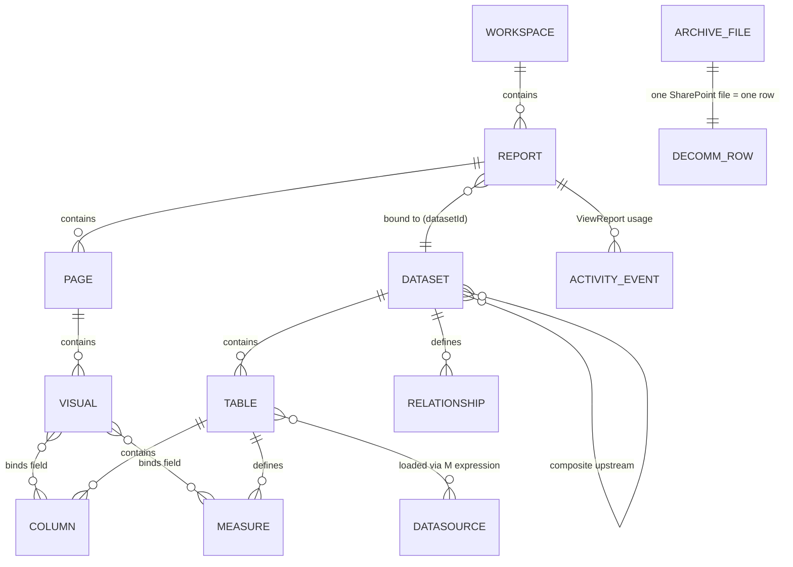

# Domain Model — Power BI Control Center

> Generated from codebase analysis, 2026-11-20. Update after adding entities
> or changing business rules (see `AGENTS.md`).

## Core entities & relationships

- **Workspace** — Power BI group; the ACL unit (`_user_allowed_workspace_ids()`).
- **Report** — has pages/visuals; bound to one dataset (composite models add
  upstream datasets).
- **Dataset / Semantic Model** — tables, columns, measures, relationships,
  datasources, refresh schedule/history.
- **Visual** — typed (chart/card/table…), bound to fields; can be *broken*
  (render error) or *blank*; has a page (which may be hidden).
- **Activity Event** — Admin API `ViewReport` events, bucketed per day.
- **PBIP project** — exported zip of `.Report` + `.SemanticModel` folders
  (TMDL text + PBIR JSON); input to the diff feature; `.pbi/cache.abf` data
  file stripped before diff; 1700 MB upload cap.
- **Catalog artifacts** (SharePoint `latest/`) — `inventory.json`,
  `impact_index.json`, `sources.json`, `summary.json`, `workspace_catalog.json`,
  `refresh_snapshot.json`, `usage_snapshot.json`, `ops_summary.json`,
  `field_usage_index.json`, `unused_fields_index.json`,
  `semantic_models_index.json`, thin packs `ui_*.json`.
- **Decommission row** — derived purely from a SharePoint archive file
  (path `batch/workspace/[folder…]/file.pbix|rdl`); no live PBI metadata involved.
- **User (UPN)** — session identity; drives ACL filtering and the archive allow-list.

## Business rules

### Crash Test health score (0–100)
Start at 100; deduct **20 per Critical, 10 per High, 5 per Medium, 2 per
warning**; floor 0. Status: ≥90 healthy, ≥70 warning, else critical (the route
re-badges: excellent ≥90 / good ≥70 / fair ≥50 / poor below).
Lineage impact: `impact_score = min(100, max_broken_field_usage × 20)`.

Crash-test phases: dataset refresh health (last 5 refreshes; Failed = Critical,
extracted from `serviceExceptionJson`), schema analysis (Scanner), visual
integrity (export + optional Playwright render scan, or frontend-supplied
`visual_field_bindings`), DAX expression validation (unmatched parens/brackets,
empty `CALCULATE()` → High), hidden-page filter analysis, lineage impact.
Issue `category` values: `Dataset Health`, `Schema Analysis`, `Broken Visual`,
`Blank Visual`, `Visual Layout`, `Visual Configuration`, `Expression Validation`,
`Page Configuration`, `Visual Integrity`. PBI error codes mapped to
human-readable reasons (`Missing_References`, `DataTypeConversionFailed`,
`InvalidExpression`, `QueryTimeout`, `InsufficientMemory`, `ConnectionFailed`,
`AuthenticationFailed`).

### Semantic-model health check
Start 100; −5 empty table; −10 orphaned tables; −5 table with >100 columns;
−10 measure without expression.

### Report similarity
`overall_score = dax×0.35 + table×0.25 + page×0.20 + visual×0.20`;
multi-type mode defaults `threshold=0.3`; results capped at 500 rows.

### Decommission
A report counts as decommissioned **iff its file exists in the SharePoint
archive tree** (`batch/workspace/[folder…]/file.pbix|rdl`); `decommissionedAt`
= SharePoint file creation time. Power BI usage-metrics system reports are
excluded via `thin_packs.is_excluded_report_name`. Inventory is cached 300 s;
SharePoint listing uses a persisted Graph delta token
(`decomm_delta_state.json`) with full-walk bootstrap.

### Archive allow-list
Only allow-listed Central Analytics users may archive:
10 hardcoded UPN local-parts × {`ashleyfurniture.com`,
`ashleyfurnitureindia.com`} + env `REPORT_ARCHIVE_ALLOWED_UPNS` +
`catalog_config.USAGE_EXCLUDE_USER_UPNS`. Export: Power BI
`Export` endpoint, 900 s timeout × 3 attempts, then upload to the latest dated
batch folder in the *Report Decommission Activity* SharePoint tree.

### Usage tracking
Admin Activity Events, `Activity eq 'ViewReport'`, lookback
`USAGE_LOOKBACK_DAYS` (default 60), fetched per-day in parallel
(10 workers), persisted as day buckets in `.usage_cache/usage_<ws>.json`;
groups/users excluded via `USAGE_EXCLUDE_GROUP_NAMES` / `USAGE_EXCLUDE_USER_UPNS`.

### Unused fields (safe-to-delete candidates)
A column/measure is "unused" only if it is NOT: bound to a visual, referenced
in any DAX (`Table[Col]`), tagged in an M expression, a relationship key, or
referenced by another measure. Documented limitation: RLS filters and sort-by
usage are not detectable.

### Catalog freshness & access
In-memory TTL 3600 s; disk mirror revalidated every
`CATALOG_DISK_REVALIDATE_SEC` (size check vs Graph metadata); SharePoint 404 →
300 s negative cache; on any SP failure the stale mirror is served. Catalog
APIs are ACL-filtered per user. Only small artifacts are downloadable via
`/api/catalog/data/<name>` (large ones hard-blocked 403). Heavy blobs stay out
of memory by config.

### Scanner/extract rules
Batches of `SCANNER_BATCH_SIZE` (100) workspaces; poll with 1 s→5 s backoff;
retries: 429 honors `Retry-After`, 401/403 force one token refresh, ≥500
exponential backoff, up to `MAX_RETRIES`. Field-usage batch runs weekly-only,
incremental on `modifiedDateTime`, checkpoints uploaded mid-run.

### Limits
PBIP diff upload 1700 MB; PBIP zip strips `.pbi/cache.abf`; stale diff temp
dirs pruned after 15 min; SharePoint upload 4 MB simple / 5 MB chunked;
report export 900 s × 3 attempts; sessions expire absolutely after 12 h
(`SESSION_MAX_HOURS`).

## Domain glossary

| Term | Meaning |
|---|---|
| **Crash Test** | Report health diagnostic: refresh + schema + visual render + DAX validation → score, issues, recommendations |
| **Broken visual** | A visual that failed to render; issue record includes `missing_fields`, `root_cause` (e.g. `DELETED COLUMN: …`), `error_reason` |
| **Blank visual** | Visual with no detectable type (`No_Visual_Type`) |
| **Impact index** | Reverse index: physical table → model tables → datasets → reports → workspaces ("blast radius") |
| **Thin pack** | Browser-sized JSON derived from a big catalog artifact (`ui_home_index`, `ui_impact_tables`, …) |
| **Scanner API** | Power BI Admin API (`/admin/workspaces/getInfo`) for tenant metadata extraction |
| **PBIP** | Power BI Desktop project export (`.Report`/`.SemanticModel` folders) |
| **TMDL** | Tabular Model Definition Language — text format inside `.SemanticModel` |
| **PBIR** | Enhanced report definition format — `pages/<id>/page.json` + `visuals/<id>/visual.json` |
| **M / Power Query** | Data-load expression language; parsed for datasource references (`Sql.Database`, `Web.Contents`, …) |
| **DAX** | Measure/c calculated-column expression language; validated for syntax issues |
| **`xmla_connector`** | Misnomer — talks DAX over REST `executeQueries`, not the XMLA endpoint |
| **Fabric API** | `api.fabric.microsoft.com` — used only for workspace folders/items |
| **Refreshable** | Admin API capacity concept used to map datasets → refresh state |
| **Orphaned / zero-views / inactive** | Home-summary report classifications (see `catalog_service.service.build_home_summary`) |
| **Ops-only / fresh** | Extract modes: incremental enrichment vs full rescan |
| **Disk mirror** | `data/catalog_cache/latest/` — size-verified local copy of SharePoint artifacts (never authoritative) |
| **Embed token (Aad vs Embed)** | Power BI embed token flavors; Aad = user token passthrough, used when SP GenerateToken is refused |
| **Delta token** | Graph delta-query state for incremental SharePoint listing |
| **UPN** | User principal name — allow-list and exclusion key |
